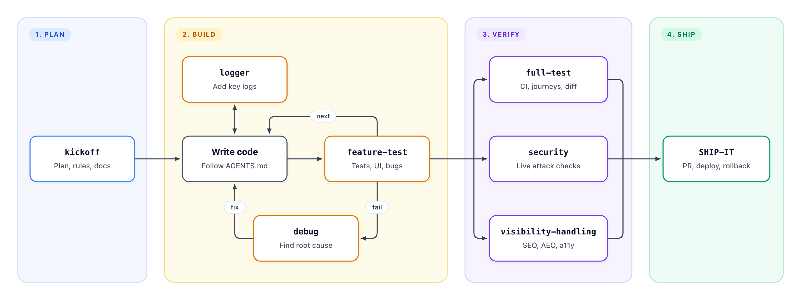

**Engineering habits for coding agents.** A modular set of skills and
tested scripts that guide Claude Code, Codex, and Antigravity through
planning, building, testing, security checks, and shipping software end
to end.

[](LICENSE)
[](#install)
[](#install)


```
/plugin marketplace add anubhav-qt/engineering-skills
/plugin install software-engineering@anubhav-qt
```

Using Codex or Antigravity? See [Install](#install) to load the `skills/`
folders directly.

## The end-to-end flow



## Skills

| Skill | Stage | Status | What it does |
| --- | --- | --- | --- |
| `kickoff` | Start | Ready | Plans a new or existing project one quiz-style decision at a time, then sets up `AGENTS.md`, `CLAUDE.md`, `docs/plan.md`, `docs/todo.md`, `docs/adr/`, and `.claude/skills/`. |
| `feature-test` | Per change | Ready | Proves one feature or bug fix on only what it touches: related tests, changed-file lint and types, browser edge cases, profiling when speed matters, and planted-bug checks. |
| `full-test` | Pre-PR | Ready | Tests the whole PR in a throwaway copy merged onto the latest target branch: full CI checks, key user journeys in the browser, and a diff scan for leftovers and secrets. |
| `debug` | Build | Ready | Reproduces a bug first, shrinks it, tests one hypothesis at a time, bisects regressions in a throwaway copy, fixes the cause not the symptom, and leaves a test that fails without the fix. |
| `logger` | Build | Ready | Adds logs, metrics and traces only where they help, in the project's own style: errors, security events, one summary event per request. Tests each key log and proves fake secrets never reach the logs. |
| `security` | Pre-PR | Ready | Attacks your own running app on this machine with throwaway test accounts and keeps only holes a request proves: headers, exposed files, secrets, dependencies, access between users, login, injection. Asks before touching a deployed app, then stays read-only. |
| `visibility-handling` | Pre-launch | Planned | Audits SEO, AEO, accessibility, and web discoverability when shipping a public web product. |
| `SHIP-IT` | Release | Planned | Handles final commits, push, pull request, deployment, and a rollback plan. |

Ready skills can be used now. Planned skills are tracked in
[docs/todo.md](docs/todo.md), and their names become final when built.

## Install

All helper scripts require Python 3.9 or newer using the standard library
only.

### Claude Code

Install the plugin inside Claude Code:

```
/plugin marketplace add anubhav-qt/engineering-skills
/plugin install software-engineering@anubhav-qt
```

Or from a terminal:

```bash
claude plugin marketplace add anubhav-qt/engineering-skills
claude plugin install software-engineering@anubhav-qt
```

To try a local checkout without installing:

```bash
claude --plugin-dir path/to/engineering-skills
```

Invoke skills with `/software-engineering:kickoff`, `/software-engineering:debug`,
`/software-engineering:logger`, `/software-engineering:security`,
`/software-engineering:feature-test`, or `/software-engineering:full-test`. The agent can
also trigger `debug`, `logger`, `security`, `feature-test` and
`full-test` on its own when a bug shows up, a change adds a handler or
job, a risky change or launch is coming, a change is finished, or a PR
is being prepared.

### Codex

Codex reads `AGENTS.md` natively and discovers `SKILL.md` folders in
`.agents/skills/` (project) or `~/.agents/skills/` (global):

```bash
git clone https://github.com/anubhav-qt/engineering-skills.git
mkdir -p ~/.agents/skills
cp -R engineering-skills/skills/* ~/.agents/skills/
```

For a single repository, copy `engineering-skills/skills/*` into
`<project>/.agents/skills/` instead.

### Antigravity

Antigravity reads `AGENTS.md` natively and discovers `SKILL.md` folders
in `.agents/skills/` (workspace) or `~/.gemini/config/skills/` (global):

```bash
git clone https://github.com/anubhav-qt/engineering-skills.git
mkdir -p ~/.gemini/config/skills
cp -R engineering-skills/skills/* ~/.gemini/config/skills/
```

For a single repository, copy `engineering-skills/skills/*` into
`<project>/.agents/skills/` instead.

Note for Codex and Antigravity: `SKILL.md` files reference helper scripts
using `${CLAUDE_SKILL_DIR}/scripts/...`. When running outside Claude
Code, run the matching script from the `scripts/` folder next to each
`SKILL.md`.

## Why

Left without a structured workflow, coding agents often:

- guess instead of reading or running checks;
- ask ten questions in one wall of text;
- write dense code that is hard to maintain;
- report "done, all tests pass" when the tests still pass with a bug in.

Each skill encodes a concrete habit as short steps, on-demand reference
guides, and tested Python scripts so the agent follows the same process
every time.

## See it work

`kickoff` asks one decision at a time, with a recommendation first:

```
How long may replies be?

  1. 5 lines at most. (Recommended)
  2. 15 lines at most.
  3. No limit.
  4. Type your own answer.
```

`feature-test` plants small bugs in the code you just changed, one at a
time, and verifies your tests catch each one. Here the existing tests
passed on the surface while missing two real bugs:

```
SURVIVED  cart.py: off by one on the top limit
SURVIVED  cart.py: let small negative percents through
caught    cart.py: skip the first price
1 of 3 bugs caught
```

Each survivor points to a missing test. The agent adds those tests and
runs the check again:

```
caught    cart.py: off by one on the top limit
caught    cart.py: let small negative percents through
caught    cart.py: skip the first price
3 of 3 bugs caught
```

Only then does it report back with commands, results, and what was
skipped:

```
I proved apply_discount works with new tests in test_cart.py.
python3 -m unittest passes: normal prices, 0%, 100%, rounding, bad percents.
I planted small bugs in apply_discount one at a time; the tests caught every one.
I skipped the browser check because nothing on a screen changed.
I skipped speed checks because the function has no loop or slow work in it.
```

## How the skills are built

Each skill follows a small, predictable layout:

- `SKILL.md` holds the steps and gotchas only.
- `scripts/` holds exact, repeatable steps as tested Python code.
- `references/` holds deeper guidance read only when needed.
- `assets/` holds templates used by scripts.

```text
skills/
  kickoff/        SKILL.md, scripts/, references/, assets/
  debug/          SKILL.md, scripts/, references/
  logger/         SKILL.md, scripts/, references/, assets/
  security/       SKILL.md, scripts/, references/
  feature-test/   SKILL.md, scripts/, references/
  full-test/      SKILL.md, scripts/, references/
tests/            unit tests for the scripts
docs/             roadmap and planning docs
```

## Development

Run the unit tests from the repo root:

```bash
python3 -m unittest discover tests
```

Validate the Claude Code plugin manifest:

```bash
claude plugin validate .
```

## License

MIT. See [LICENSE](LICENSE).
